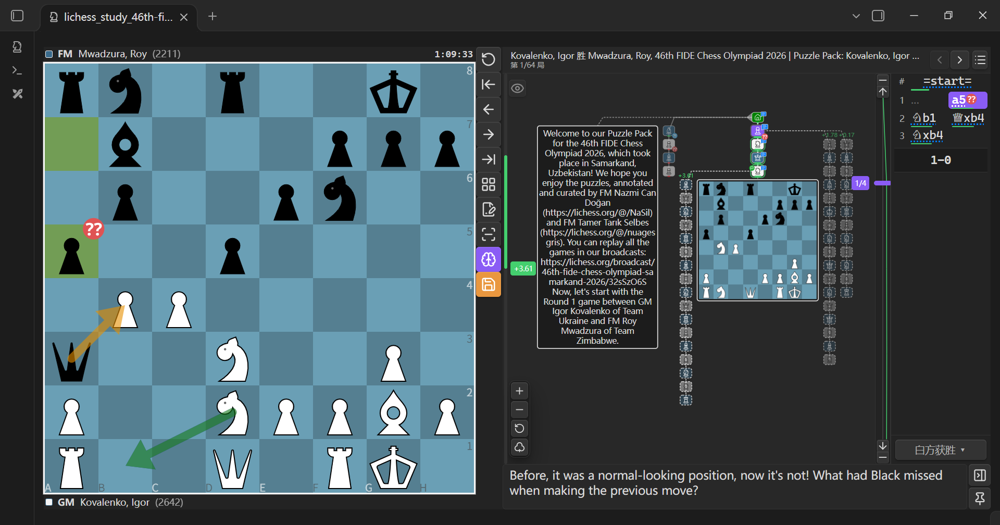
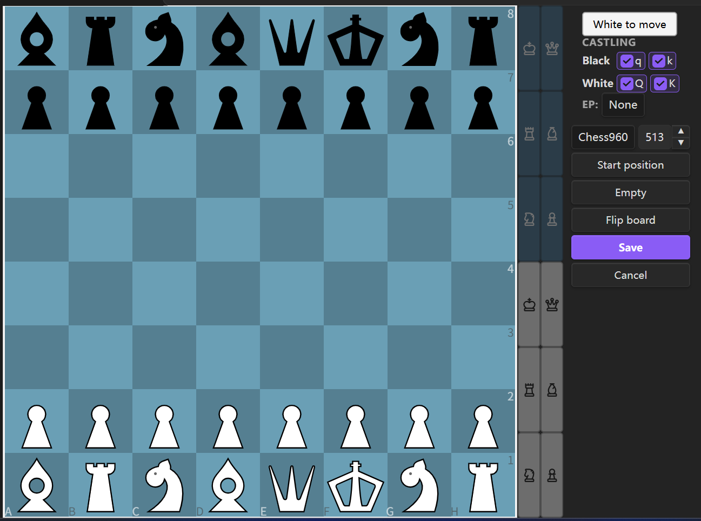
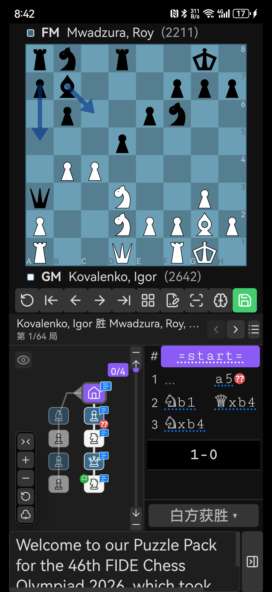
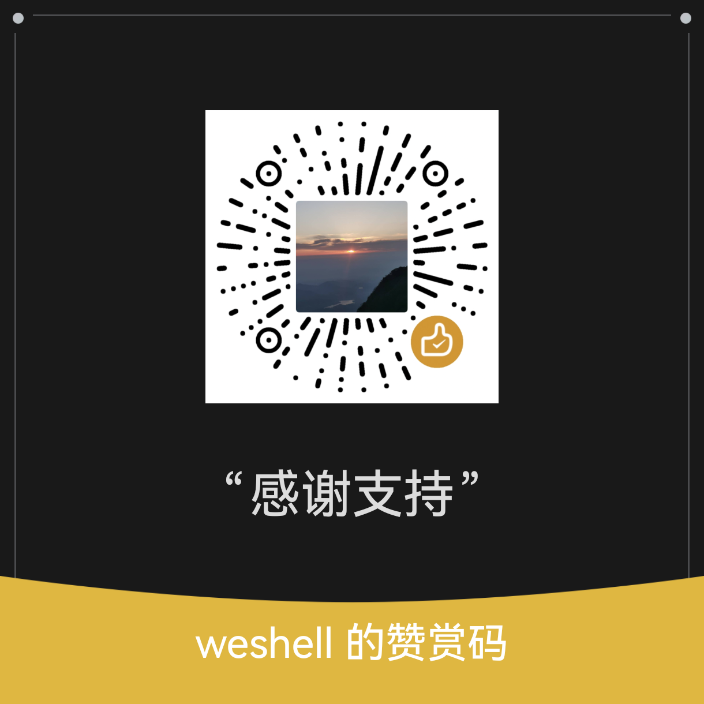

# Chess Tree


[](./LICENSE)
[](https://discord.gg/FQhgku2Cr)
[](https://paypal.com/paypalme/weshell1988)
[](https://afdian.com/a/weshell)

> Play, explore and analyze chess right inside your Obsidian notes — full PGN support, interactive boards, variation trees, Chess960 (Fischer Random) and a built-in Stockfish 18 engine (WASM).



English | [中文文档](./README.zh.md)

## Getting Started

There are three ways to use the plugin — all of them end up on the same interactive board.

### Open a PGN file

Any `.pgn` file opens in a dedicated chess view: browse the variation tree, edit moves and comments, run engine analysis, and save back to the file with one click. Multiple games in one file are managed via the game navigation bar — switch, add, reorder, or delete them — and the ribbon button creates a new PGN file in your configured folder, opening the rename dialog so you can name it right away. The file context menu switches a PGN file between the chess view and the Markdown view.


### Embed a game in a note

Write moves in a `chess` code block — the position renders as an interactive board with the full variation tree:

````markdown
```chess
1. e4 e5
2. Nf3 Nc6
3. Bb5 a6
```
````

Optional parameters: `protected`/`p` (disable Save), `rotated`/`r` (flip board). FEN is optional — with quotes or without:

````markdown
```chess
r:true
[FEN "rnbqkbnr/pppppppp/8/8/4P3/8/PPPP1PPP/RNBQKBNR b KQkq - 0 1"]
1... e5 2. Nf3 Nc6
```
````

### Set up a position

A `fen` code block opens a visual position editor — drag or click to place pieces, set the side to move, then save. It becomes a playable `chess` code block containing the FEN.



## Feature Tour

### Variation Tree & Keyboard Navigation

Every branch is visualized as a tree graph — click any node to jump to that position, and switch between icon and text label modes. Nodes are laid out at their real pixel size, so labels, pinned blocks and previews never overlap. The current branch's arrows render at full opacity while sibling branches fade to 50%, so the line you're on stands out. Keyboard shortcuts keep your hands on the board:

| Shortcut                                | Action                                                                                             |
| --------------------------------------- | -------------------------------------------------------------------------------------------------- |
| `Ctrl+↑` / `Ctrl+↓`                     | Jump to the previous / next fork (branching point) along the line                                  |
| `Ctrl+←` / `Ctrl+→`                     | Switch the displayed branch at the first unfolded fork below the current node (wraps)              |
| `Ctrl+Alt+Shift+←` / `Ctrl+Alt+Shift+→` | Cycle through every visible variation below the current node (wraps)                               |
| `Alt+←` / `Alt+→`                       | Cycle through every branch's node at the current ply (short or folded branches are skipped; wraps) |
| `Alt+Shift+←` / `Alt+Shift+→`           | Jump between the ends of all visible branches (wraps)                                              |
| `Ctrl+Shift+←` / `Ctrl+Shift+→`         | Cycle between the first steps of all visible branches (wraps)                                      |
| `↑` / `↓` / `←` / `→`                   | Step one move back / forward; jump to game start / end                                             |

These shortcuts work in the PGN file view and in `chess` code blocks alike. In the PGN view they are built into the view and active while it is focused. In a code block, click the board (or anywhere on the block) first — the focused block takes the shortcuts; click back into the note to return to typing. On macOS, `Ctrl+↑`/`Ctrl+↓` may conflict with Mission Control. All branch-switching shortcuts skip branches hidden by folding. All PGN view navigation actions are also available as commands in the Command Palette — without preset hotkeys, to avoid conflicts with core and other plugins; assign your own in Settings → Hotkeys if you want global bindings.

### Pin to the Tree

Keep annotations visible while you browse — the tree itself carries the extras:

- **Pinned comments**: the pin button in the comment box renders the comment as a text block on the tree, connected to its move node
- **Pinned board previews**: right-click any tree node → **Pin board preview** to keep that position's board on the tree
- **Grouped cards**: a node's board preview and pinned comment form one aligned card
- **Persistence**: pins are stored as `[%pin]` PGN markers, so they survive reloads; save options control what gets written back

The right-click node menu also promotes and reorders branches and applies annotations, acting on the right-clicked node without moving the current one.

### Chess960 (Fischer Random)

Full Chess960 support, verified move-by-move against [chessops](https://github.com/niklasf/chessops):

- **Position picker**: the board editor's variant dropdown switches between the standard start and Chess960; pick any of the 960 positions by official number (0–959, 518 = standard) or step through them with the ▲/▼ spinner; the **Insert random Chess960 position** command drops a ready-to-play block into the note
- **Correct castling**: X-FEN and Shredder-FEN castling fields; king-takes-rook input (`O-O`, or drag the king onto its rook)
- **Engine-ready**: Stockfish runs with `UCI_Chess960` enabled, so analysis and engine play understand 960 castling
- **PGN round-trip**: games from a 960 start are exported with `[Variant "Chess960"]`

### Engine Analysis

Built-in Stockfish 18 (WASM) — no external installation needed.

- **Single / batch / auto analysis**: analyze one position, every node, or automatically as you play
- **Best-move & ponder arrows**: green for best move, yellow for the ponder move
- **Eval bar**: live evaluation beside the board (green = white advantage, red = black)
- **Eval trend chart & node color bars**: see the whole game's evaluation at a glance
- **Instant eval attribution**: eval bars light up along a searched line without re-running the engine — display only, every position still gets its own full-depth search
- **Ghost lines**: engine principal variations render on the tree graph as dashed ghost lines — toggle them, pick how many lines (1–5) and how deep each one goes (1–20 plies) in settings
- **Live streaming**: analysis results (eval, arrows, ghost lines) update progressively per depth while the engine searches
- **Persistence**: evaluations are stored as `%e:` comments in PGN
- **Engine play**: play against the engine with configurable depth (1–30) and skill level (0–20)
- **Engine simulation**: let the engine play White, Black, or both sides (self-play) from the analysis menu, with a configurable move interval (0.1–10 s); it stops by itself on game end, threefold repetition, or the 50-move rule

### Board & Pieces

- **8 board styles**: Wood, Wood Grain, Newspaper, Green, Blue, Grey, Dark, Light — with a swatch picker in the board menu
- **42 lichess piece sets**: Cburnett, Merida, Alpha, … switchable in settings or the board menu
- **Board markers**: draw arrows and highlights on the board
- **Feedback options**: last-move highlight, legal-move hints, turn border, move sounds, spoken moves (desktop)
- **Board editor**: **Edit board** turns any game into a position editor; existing moves are discarded on save

### Move List

Grid-aligned move columns with figurine (♔♕♖♗♘) or letter (SAN) notation, adjustable font size, and per-move marks — eval bar, annotation badge, glyph (!?/??…) and comment underline — each independently toggleable. Hovering a move in the list or a node in the tree graph pops up a mini board with that position.

### Export & Share

- **PNG snapshot**: export the current board as a 1024 px image with your theme and piece set
- **Animated GIF**: export the mainline, the current branch, or every game in the file as a 512 px GIF with a configurable frame interval (0.1–10 s)
- **Save-as dialog**: pick the destination before saving — fuzzy folder picker (`/` = vault root) plus filename, with an overwrite confirmation; missing folders are created automatically
- **Default export folder**: a settings field that prefills the save-as dialog (unset falls back to Obsidian's attachment-folder setting)

### Mobile

The layout adapts to small screens. For best results, combine it with a fullscreen plugin (e.g. [obsidian-full-screen-cross-platform-plugin](https://github.com/donkeypacific/obsidian-full-screen-cross-platform-plugin)) and tune the top/bottom board margins in settings.



## Settings Overview

All options live in **Settings → Chess Tree**, grouped as follows:

| Group            | What you can configure                                                                                                                                 |
| ---------------- | ------------------------------------------------------------------------------------------------------------------------------------------------------ |
| Language         | UI language: Auto (follow app) or a fixed language                                                                                                     |
| Board Appearance | Board style, piece set, board zoom, coordinate labels, annotation glyphs on the board                                                                  |
| Game Hints       | Last-move highlight, legal moves, other variations, turn border, sounds & volume, spoken moves, auto jump                                              |
| Move List        | Visibility, font size, notation, per-move marks, hover position preview                                                                                |
| Engine Analysis  | Depth, skill level, simulation interval, best-move & ponder arrows, auto annotate, ghost line visibility/count/depth                                   |
| Save             | Include eval on save, ask-before-saving (evals & pinned blocks), save pinned blocks, annotation format (symbol / NAG / comment), default export folder |
| Board Margins    | Top/bottom margin (0–100 px) for fullscreen layouts                                                                                                    |
| Code Block Names | Game-mode (`chess`/`tree`) and edit-mode (`fen`) block aliases, FEN save target                                                                        |
| PGN File View    | Enable/disable the view, custom file extensions, new PGN file location                                                                                 |

Code block names, file extensions, and custom file types take effect after restarting the plugin or Obsidian.

## Installation

Install from Obsidian's community plugin marketplace:

1. Open **Settings → Community plugins** (Restricted mode off)
2. Click **Browse** and search for **Chess**
3. Click **Install**, then **Enable**

## Build

```bash
git clone https://github.com/west-shell/obsidian-chess-tree.git
cd obsidian-chess-tree
npm install
npm run build        # Minified production build (for release)
npm run build:debug  # Unminified production build (with sourcemaps)
```

## Credits & License

- Rules engine: [chess.js](https://github.com/west-shell/chess.js) (fork of [jhlywa/chess.js](https://github.com/jhlywa/chess.js)) — Chess960-patched fork published as [@weshell/chess.js](https://www.npmjs.com/package/@weshell/chess.js) (BSD-2-Clause)
- Board rendering: [chessground](https://github.com/lichess-org/chessground)
- Engine: [Stockfish 18](https://stockfishchess.org/) — WASM build from [nmrugg/stockfish.js](https://github.com/nmrugg/stockfish.js), re-hosted as versioned engine assets
- Piece artwork: [lichess-org/lila](https://github.com/lichess-org/lila) (public/piece/), under their respective free licenses (GPL/CC) — regenerate the embedded CSS after changing `assets/pieces/` with `node scripts/gen-piece-css.mjs`
- i18n: UI in English, 简体中文, 日本語, 한국어, Русский, Deutsch, Français and العربية

Released under [GPL-3.0](./LICENSE).

## Support the Project

[](https://paypal.com/paypalme/weshell1988)
[](https://afdian.com/a/weshell)

If you like this project, check out my [Bilibili](https://space.bilibili.com/156446344) page — likes, coins and feedback are greatly appreciated.


