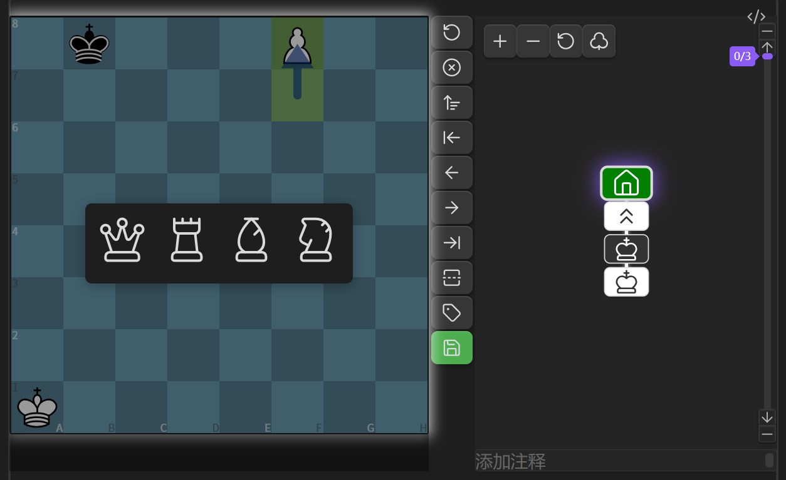
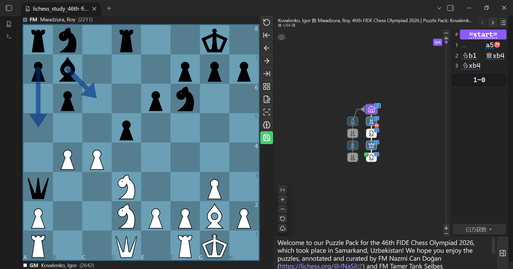
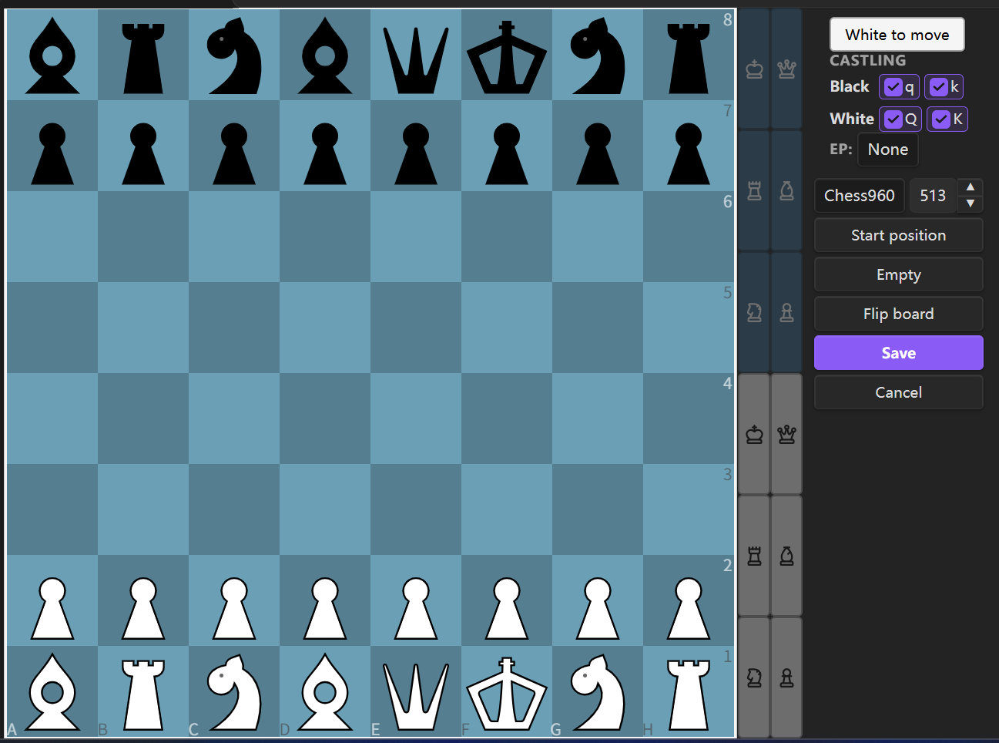
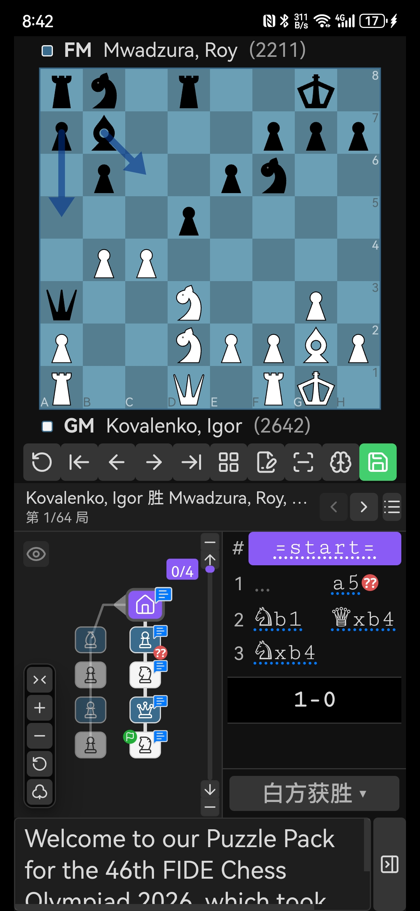

# Chess Tree


[](./LICENSE)
[](https://discord.gg/FQhgku2Cr)
[](https://paypal.com/paypalme/weshell1988)
[](https://afdian.com/a/weshell)

> Play, explore and analyze chess right inside your Obsidian notes — full PGN support, interactive boards, variation trees and a built-in Stockfish 18 engine (WASM).



English | [中文文档](./README.zh.md)

## Getting Started

There are three ways to use the plugin — all of them end up on the same interactive board.

### Open a PGN file

Any `.pgn` file opens in a dedicated chess view: browse the variation tree, edit moves and comments, run engine analysis, and save back to the file with one click. Multiple games in one file are supported via the game navigation bar, and the ribbon button creates new PGN files instantly.



### Embed a game in a note

Write moves in a `chess` code block — the position renders as an interactive board with the full variation tree:

````markdown
```chess
1. e4 e5
2. Nf3 Nc6
3. Bb5 a6
```
````

Optional parameters: `protected`/`p` (disable Save), `rotated`/`r` (flip board). FEN is optional — with quotes or without:

````markdown
```chess
r:true
[FEN "rnbqkbnr/pppppppp/8/8/4P3/8/PPPP1PPP/RNBQKBNR b KQkq - 0 1"]
1... e5 2. Nf3 Nc6
```
````

### Set up a position

A `fen` code block opens a visual position editor — drag or click to place pieces, set the side to move, then save. It becomes a playable `chess` code block containing the FEN.



## Feature Tour

### Variation Tree & Keyboard Navigation

Every branch is visualized as a tree graph — click any node to jump to that position, and switch between icon and text label modes. Keyboard shortcuts keep your hands on the board:

| Shortcut                                | Action                                                                                             |
| --------------------------------------- | -------------------------------------------------------------------------------------------------- |
| `Ctrl+↑` / `Ctrl+↓`                     | Jump to the previous / next fork (branching point) along the line                                  |
| `Ctrl+←` / `Ctrl+→`                     | Switch the displayed branch at the first unfolded fork below the current node (wraps)              |
| `Ctrl+Alt+Shift+←` / `Ctrl+Alt+Shift+→` | Cycle through every visible variation below the current node (wraps)                               |
| `Alt+←` / `Alt+→`                       | Cycle through every branch's node at the current ply (short or folded branches are skipped; wraps) |
| `Alt+Shift+←` / `Alt+Shift+→`           | Jump between the ends of all visible branches (wraps)                                              |
| `Ctrl+Shift+←` / `Ctrl+Shift+→`         | Cycle between the first steps of all visible branches (wraps)                                      |
| `↑` / `↓` / `←` / `→` (PGN view)        | Step one move back / forward; jump to game start / end                                             |

Branch navigation works in both the PGN file view and `chess` code blocks (in code blocks, hover the block and keep focus out of text editors). On macOS, `Ctrl+↑`/`Ctrl+↓` may conflict with Mission Control. All branch-switching shortcuts skip branches hidden by folding. All PGN view navigation actions are also available as commands in the Command Palette. In the PGN view the modifier-combo shortcuts are the command hotkeys themselves — deleting or rebinding them in Settings → Hotkeys takes effect in the view. The four plain arrow-key shortcuts are built into the PGN view only and are not exposed as commands, since global arrow keys would clash with the app. Code block shortcuts are built-in and hover-gated.

### Engine Analysis

Built-in Stockfish 18 (WASM) — no external installation needed.

- **Single / batch / auto analysis**: analyze one position, every node, or automatically as you play
- **Best-move & ponder arrows**: green for best move, yellow for the ponder move
- **Eval bar**: live evaluation beside the board (green = white advantage, red = black)
- **Eval trend chart & node color bars**: see the whole game's evaluation at a glance
- **Persistence**: evaluations are stored as `%e:` comments in PGN
- **Engine play**: play against the engine with configurable depth (1–30) and skill level (0–20)

### Board & Pieces

- **8 board styles**: Wood, Wood Grain, Newspaper, Green, Blue, Grey, Dark, Light — with a swatch picker in the board menu
- **42 lichess piece sets**: Cburnett, Merida, Alpha, … switchable in settings or the board menu
- **Board markers**: draw arrows and highlights on the board
- **Feedback options**: last-move highlight, legal-move hints, turn border, move sounds, spoken moves (desktop)
- **Board editor**: **Edit board** turns any game into a position editor; existing moves are discarded on save

### Move List

Grid-aligned move columns with figurine (♔♕♖♗♘) or letter (SAN) notation, adjustable font size, and per-move marks — eval bar, annotation badge, glyph (!?/??…) and comment underline — each independently toggleable.

### Mobile

The layout adapts to small screens. For best results, combine it with a fullscreen plugin (e.g. [obsidian-full-screen-cross-platform-plugin](https://github.com/donkeypacific/obsidian-full-screen-cross-platform-plugin)) and tune the top/bottom board margins in settings.



## Settings Overview

All options live in **Settings → Chess**, grouped as follows:

| Group            | What you can configure                                                                        |
| ---------------- | --------------------------------------------------------------------------------------------- |
| Board Appearance | Board style, piece set, board zoom, coordinate labels                                         |
| Game Hints       | Last-move highlight, legal moves, other variations, turn border, sounds, narration, auto jump |
| Move List        | Visibility, font size, notation, per-move marks                                               |
| Board Margins    | Top/bottom margin (0–100 px) for fullscreen layouts                                           |
| Code Block Names | Aliases for `chess`/`tree` blocks, FEN save target                                            |
| Engine Analysis  | Depth, skill level, arrows, engine/board annotations                                          |
| Save             | Include eval on save, eval prompt                                                             |
| PGN File View    | Enable/disable the view, custom file extensions                                               |

Code block names, file extensions, and custom file types take effect after restarting the plugin or Obsidian.

## Installation

Install from Obsidian's community plugin marketplace:

1. Open **Settings → Community plugins** (Restricted mode off)
2. Click **Browse** and search for **Chess**
3. Click **Install**, then **Enable**

## Build

```bash
git clone https://github.com/west-shell/obsidian-chess-tree.git
cd obsidian-chess-tree
npm install
npm run build        # Minified production build (for release)
npm run build:debug  # Unminified production build (with sourcemaps)
```

## Credits & License

- Rules engine: [chess.js](https://github.com/jhlywa/chess.js)
- Board rendering: [chessground](https://github.com/lichess-org/chessground)
- Engine: [Stockfish 18](https://stockfishchess.org/) (WASM)
- Piece artwork: [lichess-org/lila](https://github.com/lichess-org/lila) (public/piece/), under their respective free licenses (GPL/CC) — regenerate the embedded CSS after changing `assets/pieces/` with `node scripts/gen-piece-css.mjs`
- i18n: English and Chinese UI

Released under [GPL-3.0](./LICENSE).

## Support the Project

[](https://paypal.com/paypalme/weshell1988)
[](https://afdian.com/a/weshell)

If you like this project, check out my [Bilibili](https://space.bilibili.com/156446344) page — likes, coins and feedback are greatly appreciated.


