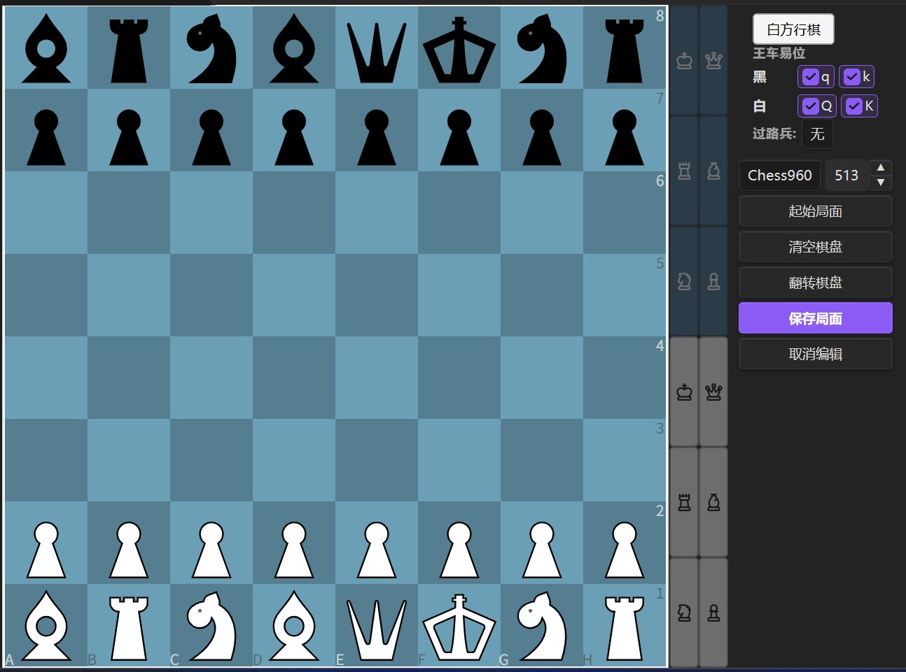

# Obsidian 国际象棋插件


[](./LICENSE)
[](https://discord.gg/FQhgku2Cr)
[](https://paypal.com/paypalme/weshell1988)
[](https://afdian.com/a/weshell)

> 在 Obsidian 笔记中直接下棋、推演和分析棋局——完整 PGN 支持、交互式棋盘、变着分支树、Chess960（菲舍尔任意制）和内置 Stockfish 18 (WASM) 引擎。


中文 | [English](./README.md)

## 快速上手

插件有三种用法，最终都落在同一个交互式棋盘上。

### 打开 PGN 文件

任何 `.pgn` 文件都会在专属的棋局视图中打开：浏览分支树、编辑着法和评论、运行引擎分析，一键保存回文件。通过棋局导航栏可管理单文件内的多局棋谱，工具栏按钮可快速新建 PGN 文件，右键菜单可在 PGN 视图与 Markdown 视图间切换。


### 在笔记中嵌入棋局

在 `chess` 代码块中写入着法，即可渲染为带完整分支树的交互式棋盘：

````markdown
```chess
1. e4 e5
2. Nf3 Nc6
3. Bb5 a6
```
````

可选参数：`protected`/`p`（禁用保存按钮）、`rotated`/`r`（翻转棋盘）。FEN 可省略，带不带引号都行：

````markdown
```chess
r:true
[FEN "rnbqkbnr/pppppppp/8/8/4P3/8/PPPP1PPP/RNBQKBNR b KQkq - 0 1"]
1... e5 2. Nf3 Nc6
```
````

### 摆一个局面

`fen` 代码块即可视化局面编辑器——拖拽或点击摆放棋子、设置行棋方，保存后生成可直接对弈的 `chess` 代码块。



## 功能一览

### 分支树与键盘导航

每个分支都以树图展示——点击任意节点跳转到该位置，可在图标/文本标签模式间切换。快捷键让你手不离盘：

| 快捷键                                  | 功能                                                                 |
| --------------------------------------- | -------------------------------------------------------------------- |
| `Ctrl+↑` / `Ctrl+↓`                     | 跳转到沿线的上一个 / 下一个分叉点                                    |
| `Ctrl+←` / `Ctrl+→`                     | 切换当前节点下方第一个未折叠分叉处的显示分支（循环）                 |
| `Ctrl+Alt+Shift+←` / `Ctrl+Alt+Shift+→` | 循环切换当前节点以下（含）的所有可见变着组合                         |
| `Alt+←` / `Alt+→`                       | 在所有分支的当前步数位置间循环切换（较短或折叠的分支自动跳过；循环） |
| `Alt+Shift+←` / `Alt+Shift+→`           | 在所有可见分支的结尾之间跳转（循环）                                 |
| `Ctrl+Shift+←` / `Ctrl+Shift+→`         | 在所有可见分支的第一步之间跳转（循环）                               |
| `↑` / `↓` / `←` / `→`（PGN 视图）       | 后退 / 前进一步；跳到棋局开头 / 结尾                                 |

分支导航在 PGN 文件视图和 `chess` 代码块中均可用（代码块中需鼠标悬停在块上，且焦点不在文本编辑器内）。macOS 上 `Ctrl+↑`/`Ctrl+↓` 可能与系统调度中心冲突。所有分支切换快捷键均跳过折叠隐藏的分支。PGN 视图的全部导航动作同时注册为命令面板中的命令。PGN 视图中带修饰键的快捷键即命令热键本身——在 设置 → 快捷键 中删除或改绑会直接作用于视图。四个纯方向键快捷键仅内建于 PGN 视图，不注册为命令（全局方向键会与应用其他部分冲突）。代码块快捷键为内建行为，需悬停触发。

### Chess960（菲舍尔任意制象棋）

完整的 Chess960 支持，逐步经 [chessops](https://github.com/niklasf/chessops) 交叉验证：

- **局面选择**：棋盘编辑器的变体下拉菜单可在标准与 Chess960 之间切换；可按官方编号（0–959，518 = 标准局面）加载任意局面，或用 ▲/▼ 微调按钮逐步切换；**插入随机 Chess960 局面** 命令可直接在笔记中生成即玩代码块
- **正确的王车易位**：支持 X-FEN 与 Shredder-FEN 易位字段；王吃车走法输入（`O-O`，或将王拖到车上）
- **引擎就绪**：Stockfish 以 `UCI_Chess960` 模式运行，分析与对弈都能理解 960 易位
- **PGN 往返**：960 起始的对局导出时自动携带 `[Variant "Chess960"]`

### 引擎分析

内置 Stockfish 18 (WASM)，无需额外安装。

- **单步 / 批量 / 自动分析**：分析单个局面、所有节点，或对弈时自动分析
- **最佳走法与思考走法箭头**：绿色 = 最佳走法，黄色 = 思考走法
- **评估条**：棋盘旁实时评估（绿色 = 白方优势，红色 = 黑方优势）
- **评估趋势图与节点色条**：全局评估走势一目了然
- **评估持久化**：评估以 `%e:` 注释保存在 PGN 中
- **引擎对弈**：可调深度（1–30）与技能等级（0–20）

### 棋盘与棋子

- **8 种棋盘风格**：木色、木纹、报纸、绿色、蓝色、灰色、深色、浅色——棋盘菜单有色板选择器
- **42 套 lichess 棋子**：Cburnett、Merida、Alpha 等，设置与棋盘菜单均可切换
- **棋局标记**：在棋盘上绘制箭头和高亮
- **对局反馈**：上一步高亮、合法走法提示、回合边框、行棋音效、朗读着法（桌面端）
- **局面编辑**：「编辑棋盘」把任意棋局切换为局面编辑器，保存后原着法将被丢弃

### 着法列表

网格对齐的着法分栏，支持棋子符号（♔♕♖♗♘）/字母（SAN）记谱、可调字号，着法旁的评估条、标注徽章、评注符号（!?/??…）和评论下划线均可独立开关。

### 移动端

布局自动适配小屏。建议配合全屏插件（如 [obsidian-full-screen-cross-platform-plugin](https://github.com/donkeypacific/obsidian-full-screen-cross-platform-plugin)）并在设置中调节上下边距，效果最佳。


## 设置总览

所有选项都在 **设置 → Chess** 中，按以下分组：

| 分组         | 可配置项                                                       |
| ------------ | -------------------------------------------------------------- |
| 棋盘外观     | 棋盘风格、棋子样式、棋盘缩放、坐标标签                         |
| 对局提示     | 上一步高亮、合法走法、其他变着、回合边框、音效、朗读、自动跳转 |
| 着法列表     | 可见性、字号、记谱方式、着法标记                               |
| 棋盘边距     | 顶部/底部边距（0–100 px），适配全屏布局                        |
| 代码块名称   | `chess`/`tree` 别名、FEN 保存目标                              |
| 引擎分析     | 深度、技能等级、箭头、引擎/棋盘标注                            |
| 保存         | 保存时包含评估、评估提示                                       |
| PGN 文件视图 | 视图开关、自定义文件扩展名                                     |

代码块名称、文件扩展名和自定义文件类型需重启插件或 Obsidian 后生效。

## 安装说明

从 Obsidian 官方插件市场安装：

1. 打开 **设置 → 第三方插件**（关闭安全模式）
2. 点击 **浏览**，搜索 **Chess**
3. 点击 **安装**，再点击 **启用**

## 构建

```bash
git clone https://github.com/west-shell/obsidian-chess-tree.git
cd obsidian-chess-tree
npm install
npm run build        # 精简版本（压缩，适合发布）
npm run build:debug  # 开发版本（不压缩，带 sourcemap）
```

## 致谢与许可

- 棋规引擎：[chess.js](https://github.com/jhlywa/chess.js) —— Chess960 补丁分支，已发布为 [@weshell/chess.js](https://www.npmjs.com/package/@weshell/chess.js)（BSD-2-Clause）
- 棋盘渲染：[chessground](https://github.com/lichess-org/chessground)
- 引擎：[Stockfish 18](https://stockfishchess.org/) (WASM)
- 棋子美术：[lichess-org/lila](https://github.com/lichess-org/lila)（public/piece/），遵循各自自由许可协议（GPL/CC）——修改 `assets/pieces/` 后运行 `node scripts/gen-piece-css.mjs` 重新生成内嵌 CSS
- 国际化：中文和英文界面

以 [GPL-3.0](./LICENSE) 许可发布。

## 支持项目

[](https://paypal.com/paypalme/weshell1988)
[](https://afdian.com/a/weshell)

如果你喜欢这个项目，欢迎到我的 [Bilibili](https://space.bilibili.com/156446344) 主页——点赞、投币、交流。


